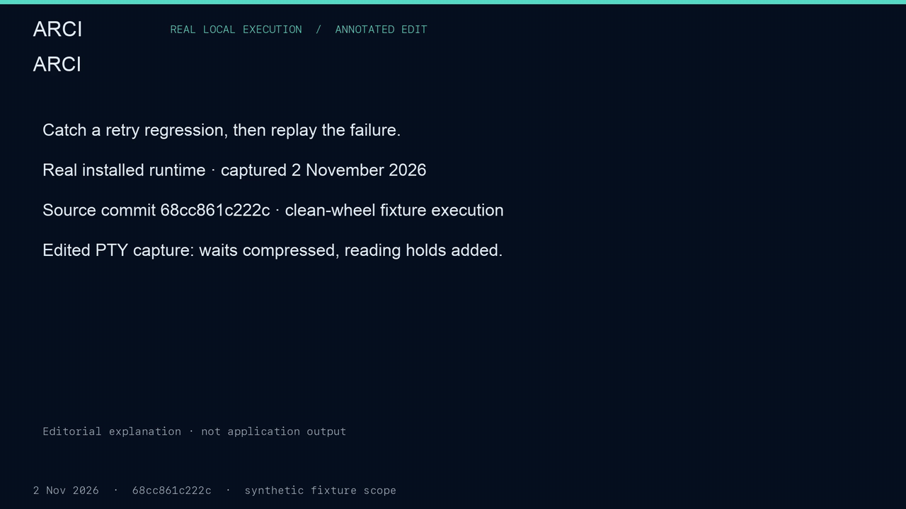
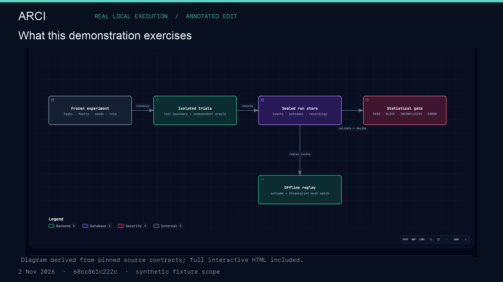
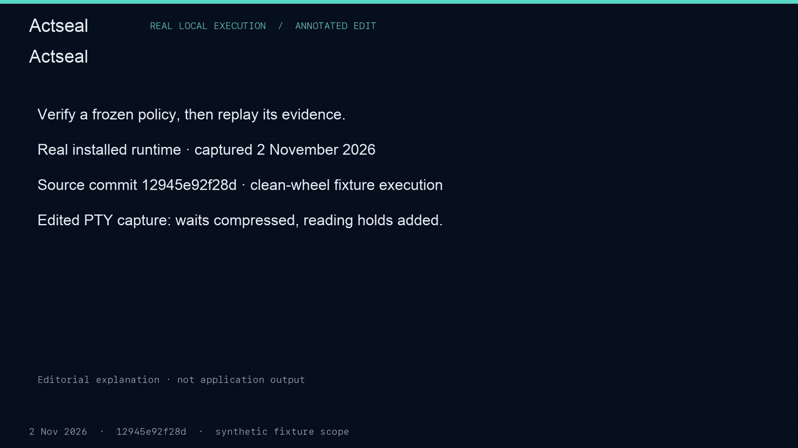
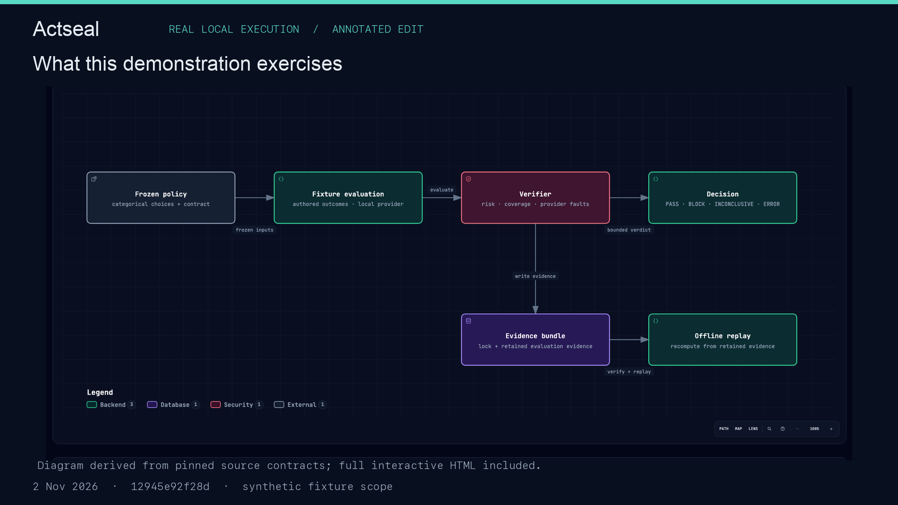

# Engineering evidence · Ajay Surya Senthilrajan

[Evidence sheet](EVIDENCE.md) · [Printable one-page PDF](Ajay_Surya_Engineering_Evidence.pdf) · [Career profile](../README.md)

Two short local fixture recordings show how I make a decision inspectable: declare the rule, run the case, retain evidence and replay the result. Captured **2 November 2026**. Each silent video is **70 seconds**.

## ARCI — from a regression to a replayable failure

**[Open the ARCI video](arci-demo.mp4)** · [Project and runnable demo](https://github.com/ajaysurya1221/agent-reliability-ci#try-the-offline-demo)

The authored retry fixture compares 192/200 baseline successes with 132/200 candidate successes: the gate returns **BLOCK**. A separately frozen comparison has 192/200 successes in each arm and returns **PASS**. The trace is compared, the injected fault set is reduced and the recorded failure is replayed. **REPRODUCED means the failure matched; it does not mean the agent succeeded.** The outer demo exits 0 when its expected assertions hold.

[Download the interactive ARCI diagram](https://raw.githubusercontent.com/ajaysurya1221/ajaysurya1221/main/showcase/arci-architecture.html) and open the saved HTML file in your browser. GitHub's file view displays its source.

The simplified path is a frozen experiment and schedule → isolated trial/tool boundary → oracle and sealed run store → statistical decision → offline replay. Seals check recorded-content integrity; this is not a claim of authenticated provenance or an OS sandbox.

## Actseal — explicit action decisions and retained evidence

**[Open the Actseal video](actseal-demo.mp4)** · [Project and runnable demo](https://github.com/ajaysurya1221/actseal)

The two authored cases use the same policy and limits with different synthetic datasets and locks. One contains 32 wrong accepted answers out of 128 and replays as **BLOCK**; the other contains zero and replays as **PASS**. This is not a trained or repaired model. The recording also shows provider-fault decisions and an existing-output-directory rejection, with existing file bytes preserved.

[Download the interactive Actseal diagram](https://raw.githubusercontent.com/ajaysurya1221/ajaysurya1221/main/showcase/actseal-architecture.html) and open the saved HTML file in your browser. GitHub's file view displays its source.

The simplified path is a frozen categorical policy → local fixture model and labelled cases → risk, coverage and fault checks → verdict and evidence bundle → offline replay. It does not establish label truth, universal calibration or deployment safety.

## Recording provenance and limits

These are **rendered PTY recordings, not desktop screencasts**. Application output comes from captured subprocesses. Waits are compressed, reading holds and editorial titles are added, selected lines are omitted, and long paths are displayed as `$RUNTIME`, `$DEMO` and `$CAPTURE`. Editorial explanations are separate from CLI output. No CLI result was fabricated.

The inline GIF previews retain the full 70-second edited runtime at 4 frames per second and 1280-pixel width. The original MP4 files retain 20 frames per second and 1920-pixel width. GitHub's MP4 file view may offer a raw-file link instead of an inline player; the animated previews and readable evidence page avoid depending on that preview service.

| Recording | Runtime | Source commit |
|---|---|---|
| ARCI | 0.8.0 | [`68cc861c222c180d1e2b2f103e141fc9047c4e9f`](https://github.com/ajaysurya1221/agent-reliability-ci/tree/68cc861c222c180d1e2b2f103e141fc9047c4e9f) |
| Actseal | 1.0.1 | [`12945e92f28d27a1984af7ee5bad1ae618f8c748`](https://github.com/ajaysurya1221/actseal/tree/12945e92f28d27a1984af7ee5bad1ae618f8c748) |

The local runtimes used wheels built from those source commits, rather than a fresh public-PyPI download. The installed-wheel SHA-256 values are `3bd3e7edebf578deaf9b00f06d964ae3165ab6015b18dc7fb0463845b294004a` (ARCI) and `37040fca09911b7c21f570be91addad54f67ee306b7d5814853a6e140d50fa46` (Actseal). The later Actseal Setuptools maintenance change is outside the recorded runtime.

[Asset hashes](MANIFEST.json) identify these videos, static and interactive diagrams, and the evidence sheet. Full video decoding, recorded exit statuses and displayed-source-line checks passed locally. These finite fixtures do not establish production safety, customer adoption or a production benchmark. No live model calls were used in the recordings. Employer code and private evidence are excluded.
